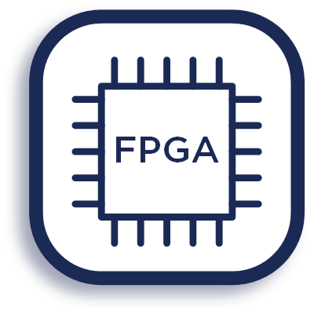

# fpgaflow

<p align="center">
  
</p>

A complete FPGA design flow with a GUI, written in Rust, for Linux.

```
Verilog / SystemVerilog ─▶ Icarus | Verilator ─▶ GTKWave
                        └▶ Yosys ─▶ VPR | nextpnr | vendor P&R ─▶ bitstream ─▶ openFPGALoader
```

- **Front end:** Verilog and SystemVerilog only.
- **Simulation:** Icarus Verilog or Verilator, selectable per project. Waveforms
  open in GTKWave.
- **Synthesis:** Yosys.
- **Place & route:**
  - VTR/VPR where it can make real bitstreams (Xilinx 7-series via F4PGA,
    QuickLogic), and for generic VTR architectures.
  - nextpnr for Lattice iCE40, ECP5 and Nexus, Gowin, Cyclone V and Xilinx
    7-series (openXC7).
  - Vendor tools (ISE, Vivado, Quartus, ...) as optional adapters for parts with
    no open bitstream flow, e.g. the Spartan-3AN through ISE 14.7.
- **Programming:** openFPGALoader. The GUI detects dev boards as you plug them in.
- **Editor:** your choice: Kate (default), KWrite, VS Code, gVim, Emacs, or a
  custom command. The same editor opens HDL sources, `fpgaflow.toml`,
  constraint files and the user config.
- **Claude integration:** generate RTL and self-checking testbenches, fix
  errors, and write constraints. It works through the Anthropic API or the
  Claude Code CLI.

## Status

Early development. Working today, from the CLI:

| Command | What it does |
|---|---|
| `fpgaflow doctor` | find every tool, show versions, check USB/udev and lz4 setup |
| `fpgaflow init <dir>` | new project skeleton |
| `fpgaflow lint` | Verilator `--lint-only -Wall` (Icarus fallback) |
| `fpgaflow sim [--tool icarus\|verilator] [--waves]` | compile and run the self-checking testbench, PASS/FAIL verdict, optional GTKWave |
| `fpgaflow waves` | open the last waveform in GTKWave with a saved or generated layout |
| `fpgaflow hier` | Yosys elaboration: module hierarchy and port lists |
| `fpgaflow synth [--family F] [--backend B]` | Yosys synthesis for the target; utilisation by resource type; netlist in the backend's format |
| `fpgaflow families` | the 24 supported families and their P&R backends |
| `fpgaflow build` | synthesis → place & route → timing → bitstream (ISE backend today) |
| `fpgaflow detect` | read-only check of the project's board (JTAG scan, or the RC10's DONE status) |
| `fpgaflow program` | load the bitstream into the FPGA (SRAM, volatile) |
| `fpgaflow boards` | known dev boards |
| `fpgaflow usb` | scan USB: known boards and openFPGALoader-supported cables |
| `fpgaflow watch` | live plug/unplug events for boards and cables (udev) |
| `fpgaflow edit [file] [--line N --col N]` | open in the configured editor (Kate by default) |

Compiler errors from Icarus, Verilator and Yosys are reported as
`file:line:col` diagnostics; ISE constraint errors point at the line in your
own UCF. All 24 families synthesise the blinky example with Yosys 0.71, and the
Spartan-3AN goes all the way to a bitstream through ISE 14.7 (timing met at
222.8 MHz for blinky).

`fpgaflow build` refuses to write a bitstream if any top-level port bit has no
`LOC` constraint, and again if the pad report shows a pin the tools placed
themselves: an unconstrained pin can drive a net wired to something else on
the board. `examples/blinky/constraints/s3an-starter.ucf` and the master
`data/boards/s3an-starter.ucf` use the pin constraints printed in AMD's UG334.

It also refuses, with no override, any `LOC` on a pin the board profile reserves: on the Celoxica RC10 that is the 14 I/O pins wired straight to a supply rail, where driving the pin low would short the rail. The error names the file and line, and the generated UCF tells ISE to `PROHIBIT` those pins too.

**Verified on hardware:**
- Spartan-3AN Starter Kit: blinky built with Yosys and ISE, loaded with
  openFPGALoader over the board's embedded Xilinx USB cable. LED0 blinks and
  BTN_SOUTH resets it.
- Celoxica RC10: blinky built with Yosys and ISE, loaded over the board's own
  USB port with `fpgaflow-celoxica`. LED0 blinks.

nextpnr/VPR backends, live board detection, the GUI and the Claude integration
are next.

## Programming the Spartan-3AN Starter Kit

1. **Power:** use a regulated 5 V supply (UG334 ch. 17). A weak adapter makes the
   board brown out, and the embedded USB cable (on a 1.8 V LDO from the 5 V
   rail) drops off USB every few seconds.
2. **USB access:** install the udev rule, then replug the USB cable:
   `sudo cp data/udev/60-fpgaflow-xilinx.rules /etc/udev/rules.d/ && sudo udevadm control --reload-rules`.
   openFPGALoader's own rules have no entry for Xilinx cables (USB vendor `03fd`).
3. **openFPGALoader with the XC3S700AN entry:** `scripts/build-openfpgaloader.sh`
   (stock v1.2.0 reads the IDCODE but has no part entry for it; submitted
   upstream as [openFPGALoader#771](https://github.com/trabucayre/openFPGALoader/pull/771)).
   The same patch adds the original Spartan-3 parts XC3S50–XC3S5000 (IDCODEs
   from ISE's BSDL files; stock v1.2.0 knows only the XC3S200). openFPGALoader
   loads the cable's FX2 firmware (`xusb_emb.hex` from ISE) itself; the cable
   then re-enumerates from `03fd:000d` to `03fd:0008`.
4. `fpgaflow build && fpgaflow program`. The JTAG clock is 750 kHz: at 6 MHz
   this cable's IDCODE reads overflowed.

## Programming the Celoxica RC10

The RC10 (XC3S1500-4FG320) is loaded over **its own USB port**, with no JTAG
cable and no Windows: `fpgaflow-celoxica` (built with fpgaflow) speaks the
board's FX2 protocol, which was read from Celoxica's PDK 4.1 driver and host
library and verified on an RC10. See `crates/celoxica/src/lib.rs`.

1. **Power:** USB alone runs the board. The PC-style 4-pin connector (CN18) is
   only needed for servos, an LCD backlight or the ATA connector's 5 V/12 V.
2. **USB access:** `sudo cp data/udev/60-fpgaflow-celoxica.rules /etc/udev/rules.d/ && sudo udevadm control --reload-rules`,
   then replug the board's USB cable.
3. Set `board = "rc10"` in `fpgaflow.toml` (the New Project dialog copies
   `data/boards/rc10.ucf`, every pin from the RC10 manual), then
   `fpgaflow build && fpgaflow program`.

Board notes (bank voltages, JTAG pinout, configuration wiring, reserved pins)
and the decoded USB protocol are in [docs/rc10/](docs/rc10/README.md);
`scripts/extract-celoxica-pdk.sh --download` fetches Celoxica's PDK 4.1
(schematic, manuals) into the git-ignored `docs/celoxica/` for local reference.

`fpgaflow build` uses the board's bitgen options (start-up on CCLK, which the
FX2 drives). Loads go into the FPGA only (volatile); `fpgaflow-celoxica`
never touches the board's flash or FX2 firmware. The reset button next to the
power connector reloads Celoxica's demo from flash. `fpgaflow-celoxica status`
shows whether the FPGA is configured.

## GUI

```sh
cargo run --release -p fpgaflow-gui -- examples/blinky
```

To install it for your user (no root needed), with an icon and an
**Engineering → FPGA Flow** entry in the KDE / freedesktop application menu:

```sh
scripts/install-desktop.sh              # release build into ~/.local/bin, menu entry, icon
scripts/install-desktop.sh --uninstall  # remove it all again
```

A splash with the icon shows for a few seconds at start-up, and again from
**Help → About FPGA Flow**.

- **Flow bar:** Lint → Simulate (Icarus or Verilator) → Waves → Synthesise →
  Build → Program, each with a status mark: ○ not run, ✔ ok, ✖ failed, yellow ✔
  sources changed since.
- **Project tree:** RTL, testbench and constraint files plus `fpgaflow.toml`,
  each opening in your editor (Kate by default).
- **Problems tab:** compiler, Yosys and ISE diagnostics; click one to open the
  file at that line and column.
- **Reports tab:** simulation PASS/FAIL, synthesis utilisation,
  implementation resources, timing (Fmax) and the pin table.
- **Boards tab and status bar:** USB boards and cables, updated live as you
  plug them in. *Program* is enabled only while the project's board is
  connected.
- **Device tab:** the die as ISE placed and routed the design, slices
  coloured by module, routing density, critical paths drawn site by site,
  and floorplan regions you draw yourself (see *Layout tools* below).
- **Pins tab:** a pin planner on the package's ball grid.
- **Doctor tab:** tool versions and host checks.
- **Settings tab:** choose the editor.
- **New project:** pick a board and its UCF is copied into the project.
- **File watching:** saving a file in the external editor marks finished
  stages as stale; saving `fpgaflow.toml` reloads the project.

## Layout tools (ISE designs)

fpgaflow reads what ISE did through text it can export: the device
(`xdl -report`, cached once per part in `~/.cache/fpgaflow/devices`), the
package (`partgen -v`), the placed and routed design (`xdl -ncd2xdl`, after
each build) and the detailed timing report. Yosys's `autoname` gives the
synthesised cells names like `u_synth.mix_l[8]`, so placement, timing paths
and area groups can be tied back to modules.

- **Device view** (`fpgaflow layout`, Device tab): use per module, the worst
  paths with the slice at each step, any instance or net, a routing-density
  heat map.
- **Pin planner** (`fpgaflow pins`, `pins set led[0] D2`, `pins clear clk`,
  Pins tab): checks every assignment against the package and the board
  (unassigned ports, configuration or power balls, reserved pins, a pin used
  twice, an I/O standard that disagrees with the bank voltage, a clock off
  its GCLK pins) and edits the project's UCF in place.
- **Floorplanner** (`fpgaflow floorplan set u_synth SLICE_X0Y0:SLICE_X23Y31`,
  Device tab > Floorplan): confines a top-level module to a rectangle as an
  ISE `AREA_GROUP` in `constraints/floorplan.ucf`, including the multipliers
  and block RAMs inside it; after the next build each region reports how
  many of the module's slices landed inside.

## Quick start

```sh
cargo build --release
./target/release/fpgaflow doctor                  # what is installed?
./target/release/fpgaflow init myproj --top top   # new project
./target/release/fpgaflow -C myproj edit          # opens fpgaflow.toml in Kate
./target/release/fpgaflow -C examples/blinky info
```

### External tools

The easiest way to get the open-source tools is the
[OSS CAD Suite](https://github.com/YosysHQ/oss-cad-suite-build). It includes
Yosys, Icarus, Verilator, GTKWave, nextpnr and openFPGALoader. fpgaflow looks in
`~/tools/oss-cad-suite/bin` and `/opt/Xilinx/14.7/ISE_DS/ISE/bin/lin64`, then
`$PATH`. Run `fpgaflow config` to change the search paths or pin individual
tools.

## Project file

```toml
[project]
name = "blinky"
top  = "blinky"

[sources]
rtl = ["rtl/**/*.sv"]
tb  = ["tb/**/*.sv"]

[sim]
tool   = "verilator"   # or "icarus"
tb_top = "tb_blinky"
wave   = "fst"

[synth]                # all optional
frontend = "verilog"   # or "slang" for full SystemVerilog (yosys-slang)
# script = "synth/custom.ys"   # replaces the family's synth command
# extra  = ["opt -full"]       # run after synthesis

[target]
family  = "spartan3a"
device  = "xc3s700an"
package = "fgg484"
backend = "ise"

[program]
mode = "sram"          # or "flash"
```

## Roadmap

1. Skeleton: project model, Doctor, job runner, editor launcher, CLI *(done)*
2. Simulation: Icarus and Verilator, GTKWave, clickable diagnostics *(done)*
3. Synthesis: Yosys for every supported family *(done)*
4. P&R and bitstream:
   - ISE 14.7 (Spartan-3AN) first *(done)*
   - then nextpnr (iCE40, ECP5)
   - then VPR (generic arch, F4PGA xc7)
   - then Gowin, Nexus, Mistral and openXC7
   - then the other vendor adapters
5. Programming *(done for the Spartan-3AN kit)* and live board detection (udev) *(done)*
6. Claude integration (API and Claude Code CLI)
7. egui GUI over all of the above *(first version done)*, plus packaging

## Licence

Dual-licensed under [MIT](LICENSE-MIT) or [Apache-2.0](LICENSE-APACHE), at your
option.
